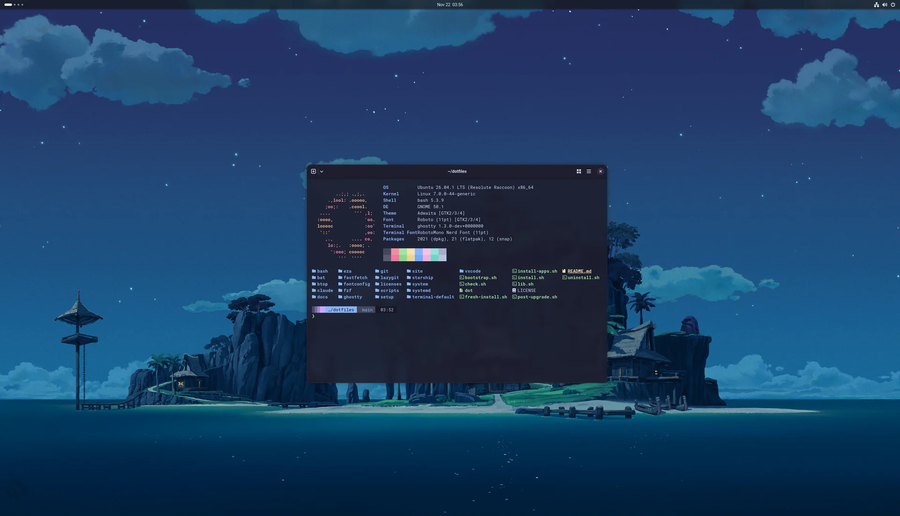

<div align="center">

# dotfiles

**My Ubuntu 26.04 GNOME setup, rebuilt on a new computer with one command.**

Terminal, desktop look, apps and upkeep, all in Catppuccin Mocha with Roboto fonts.

[](https://github.com/ronaldo-kwan/dotfiles/actions/workflows/check.yml)
[](https://ronaldo-kwan.github.io/dotfiles/)
[](https://ubuntu.com/download/desktop)
[](LICENSE)

[**Pick your setup on the website**](https://ronaldo-kwan.github.io/dotfiles/) · [**Read the docs**](https://ronaldo-kwan.github.io/dotfiles/docs/) · [Quick start](#quick-start) · [Everyday use](#everyday-use) · [Docs](#documentation)

<br>



<sub>A fresh Ubuntu 26.04 right after setup.</sub>

</div>

## What's inside

| Area | What you get |
|---|---|
| **Terminal** | bash with [ble.sh](https://github.com/akinomyoga/ble.sh), the [Starship](https://starship.rs) prompt, [Ghostty](https://ghostty.org), fzf, zoxide, eza, bat, btop, lazygit and fastfetch, all in Catppuccin Mocha, with the RobotoMono Nerd Font |
| **Desktop** | Adwaita dark with a blue accent, Roboto fonts, close-only window buttons, 4 workspaces, GNOME extensions, keyboard shortcuts, dock and wallpaper; frosted glass (Blur my Shell) on the top bar, overview and terminal; the login and lock screens in the same blurred, dark look |
| **Apps** | Chrome, VS Code, Claude Desktop, Claude Code, ChatGPT, Proton VPN, OBS, ONLYOFFICE and Steam from their makers; Ubuntu apps; Flatpaks such as Firefox, Discord and Obsidian |
| **System** | NVIDIA driver, firmware updates, firewall, weekly updates and a monthly clean-up |
| **Safety** | A secret check before every commit, signed commits, a weekly reminder to save settings, and a health check |

## Quick start

> [!TIP]
> Only want some of it? [The website](https://ronaldo-kwan.github.io/dotfiles/) lets you pick groups and single apps, then gives you your own command.

1. Install Ubuntu 26.04. On a Lenovo Legion 5, read [Before installing Ubuntu](docs/new-computer.md#before-installing-ubuntu) first.
2. Open a terminal (<kbd>Ctrl</kbd> + <kbd>Alt</kbd> + <kbd>T</kbd>) and run:

   ```bash
   bash <(wget -qO- https://raw.githubusercontent.com/ronaldo-kwan/dotfiles/main/bootstrap.sh)
   ```

3. Type your name and email for git, press <kbd>Enter</kbd> for **Yes to everything**, and type your password once. It runs by itself and restarts at the end.

It checks first that this is Ubuntu 26.04 with GNOME, and asks before going on if not. No GitHub account or sign-in is needed. Afterwards, `gh auth login` signs you in to GitHub for your notes, pushing and signed commits.

Explained step by step in [Setting up a new computer](docs/new-computer.md).

## Everyday use

Everything goes through one command, `dot`. On its own, **`dot` opens a menu** that shows whether anything is unsaved or new on GitHub, with the cursor already on what to do next. Or type a command directly: `dot help` lists them, `dot help push` (or `dot push --help`) explains one with examples, and <kbd>Tab</kbd> completes commands and options.

| Command | What it does |
|---|---|
| `dot push` | Refreshes the snapshots in `setup/` (apps, extensions, dock, desktop settings), shows what will be saved, and asks before committing and pushing, your Obsidian notes too. The message says what changed ("Update desktop settings"), or give your own: `dot push "Add Steam"`. `--dry-run` only shows it |
| `dot pull` | Gets changes you saved on another computer, then offers to apply them |
| `dot check` | Health check: links, tools, apps, extensions, firewall, signing, backups, unsaved changes. If something's wrong, offers to fix each problem in order (asks first) |
| `dot cd` · `dot edit` | Go to `~/code/github/dotfiles` · open it in VS Code |
| `dot install` · `dot apps` · `dot fresh` | Run the setup scripts again (each is safe to rerun) |
| `dot uninstall` | Undo it: your own config files back, Ubuntu's desktop look, extensions and fonts removed. `--apps` also removes the apps you pick ([details](docs/new-computer.md#undoing-it)) |
| `update` | Update Ubuntu packages now (it also happens weekly by itself) |

> [!NOTE]
> Config files like `~/.bashrc` are links into `~/code/github/dotfiles`, so editing either place edits the same file.

### When to run what

| When | Run |
|---|---|
| You changed settings, apps, extensions, the dock or your notes | `dot push` |
| You saved changes on another computer | `dot pull` |
| Something seems off or missing | `dot check` |
| First time on a computer, for **Verified** commits | `dot ssh` (one approval in the browser) |
| After upgrading Ubuntu to a new release | `dot upgrade` ([why](docs/maintenance.md#after-upgrading-ubuntu)) |

### What runs by itself

- **Weekly updates** for Ubuntu and Flatpak apps, and a **monthly clean-up** of unused packages.
- **A weekly reminder** (Sunday evening, or your next login) if settings changed since the last `dot push`, Ubuntu apps aren't saved, backups are off, changes aren't pushed, or GitHub has changes from another computer. It never commits anything.
- **A secret check** before every commit here and in your notes repo. It stops the commit if something looks like a password, token or key.

## Use it yourself

You're welcome to use or adapt this. The scripts install *my* apps and settings, so:

1. **Fork** this repo, then in your fork edit:
   - `setup/git-identity`: your name and email, suggested for git commits (saved per computer, never committed)
   - `setup/apt-packages.txt`, `setup/flatpaks.txt`, `setup/vscode-extensions.txt`, `setup/gnome-extensions.txt`: your apps
   - the `APPS` list in `install-apps.sh`: which outside apps to install (and `APP_PARTS` below it: what each one adds, so `dot uninstall --apps` can remove it)
   - the configs in `home/bash/`, `home/ghostty/`, `home/starship/` and so on, to taste. `home/claude/` holds my Claude Code instructions; delete it if you don't want them.
2. On a fresh Ubuntu, run the one command with your fork:

   ```bash
   DOTFILES_REPO=https://github.com/YOU/dotfiles.git bash <(wget -qO- https://raw.githubusercontent.com/YOU/dotfiles/main/bootstrap.sh)
   ```

3. On your current computer, run `dot push` to save your own desktop settings into `setup/`.

Notes aren't part of it: `install.sh` looks for a private repo of yours called `obsidian-vault` and skips it if there's none.

Changed your mind? `dot uninstall` puts your own config files back and returns the desktop to Ubuntu's look; `dot uninstall --apps` removes the apps too. See [Undoing it](docs/new-computer.md#undoing-it).

## Documentation

The same pages, with search, are also on the [docs website](https://ronaldo-kwan.github.io/dotfiles/docs/).

| Page | What it covers |
|---|---|
| [Setting up a new computer](docs/new-computer.md) | Before installing, both install options, what the setup does, after the restart, disk encryption, the RTX 5060, manual setup |
| [Apps](docs/apps.md) | `install-apps.sh`, where each app comes from, Steam, Obsidian, GNOME extensions |
| [Keeping things up to date](docs/maintenance.md) | `dot push`, `dot pull`, `dot check`, `dot ssh`, the reminder, the secret check, updates, upgrading Ubuntu, GitHub checks, the website |
| [What's in this repo](docs/files.md) | Every file and folder |

## Credits

Built with [GNU Stow](https://www.gnu.org/software/stow/) and [gum](https://github.com/charmbracelet/gum). Colours by [Catppuccin](https://catppuccin.com); the wallpaper is from [catppuccin-wallpapers](https://github.com/zhichaoh/catppuccin-wallpapers) (MIT; see [`licenses/wallpaper.txt`](licenses/wallpaper.txt)). The bat, eza and fzf colours are Catppuccin's own themes ([`licenses/catppuccin.txt`](licenses/catppuccin.txt)).

## Security

Found a security problem? Please report it privately: see [SECURITY.md](SECURITY.md).

## Licence

[MIT](LICENSE). The Catppuccin themes keep their own MIT licence.
